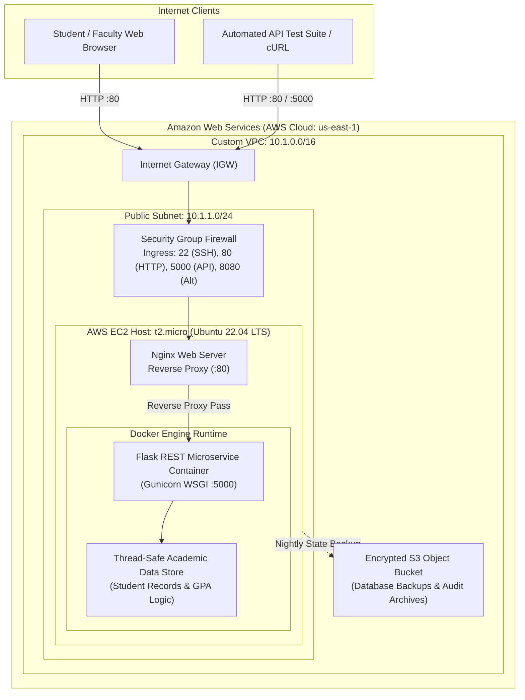

# Enterprise Student Record & Academic Management Platform (`SU_DevOps`)

[](https://www.python.org/)
[](https://flask.palletsprojects.com/)
[](https://www.docker.com/)
[](https://www.terraform.io/)
[](https://www.ansible.com/)
[](https://aws.amazon.com/)

> **Comprehensive DevOps Engineering Repository across Units 1, 2, 3, and 4.**  
> Transforming an enterprise academic management concept into a containerized, tested microservice deployed automatically to Amazon Web Services using Infrastructure as Code (Terraform) and Configuration Management (Ansible).

---

## 1. Repository Directory Structure

```
SU_DevOps/
├── README.md                                    # Master repository overview & architecture guide
├── .gitignore                                   # Standardized Git exclusion rules
│
├── unit-1-product-engineering/                  # Unit 1: Product Discovery & Specification
│   ├── README.md                                # Unit overview & engineering methodology
│   ├── FRS_NFRS_Specification.md                # Functional & Non-Functional Requirements Spec
│   └── Design_Thinking_Report.md                # 5-Stage Stanford Design Thinking Report
│
├── unit-2-agile-planning/                       # Unit 2: Agile Project Management & Scrum
│   ├── README.md                                # Scrum framework overview & ceremony guide
│   ├── Product_Backlog.md                       # Prioritized backlog table with story points
│   └── Sprint_Plan.md                           # 2-Sprint plan, DoD/DoR, and framework comparisons
│
├── unit-3-application-development/              # Unit 3: Microservice & Container Runtime
│   ├── README.md                                # Microservice setup & deployment guide
│   ├── requirements.txt                         # Python dependencies (Flask, Pytest, Gunicorn)
│   ├── Dockerfile                               # Multi-stage lightweight Python 3.10 container
│   ├── app/
│   │   ├── __init__.py                          # Application factory exports
│   │   ├── main.py                              # Flask REST API endpoints & error handlers
│   │   └── models.py                            # Student domain entities & grading logic
│   └── tests/
│       ├── __init__.py                          # Test package init
│       └── test_app.py                          # 14 Pytest test cases (100% pass rate)
│
└── unit-4-infrastructure-automation/            # Unit 4: Cloud IaC & Config Automation
    ├── README.md                                # Two-tier DevOps orchestration handbook
    ├── terraform/
    │   ├── main.tf                              # AWS VPC, Subnet, IGW, SG, EC2 & S3 definitions
    │   ├── variables.tf                         # Configurable deployment input variables
    │   └── outputs.tf                           # Exported attributes (Public IP, URLs)
    └── ansible/
        ├── playbook.yml                         # Idempotent Docker, Nginx & app deployment
        └── inventory.ini                        # Target server inventory & SSH connection vars
```

---

## 2. End-to-End System Architecture



---

## 3. Four-Unit Curriculum Synthesis

### Unit 1: Product Engineering & Design Thinking
- **Functional Requirements (FRS):** Complete specifications for 6 academic modules (Authentication & RBAC, Student Record Management, Course Registration, Attendance Tracking, Marks & Academic Performance, and Institutional Reporting).
- **Non-Functional Requirements (NFRS):** Rigorous quality attributes spanning Security (TLS 1.3, AES-256), Performance (p95 latency < 150ms), Availability (99.9% SLA), and DevOps maintainability.
- **Design Thinking:** Stanford d.school 5-stage framework applied through ethnographic user research, Empathy Maps for 3 personas (Aarav Patel, Dr. Sunita Rao, Rajesh Kumar), POV and "How Might We" problem framings.

### Unit 2: Agile Project Planning & Scrum
- **Prioritized Product Backlog:** Formatted table of 20 detailed user stories spanning Epics 1 through 7 with story point estimates using the modified Fibonacci sequence (1 to 13) and MoSCoW rankings.
- **2-Sprint Execution Roadmap:**
  - *Sprint 1 (20 SP):* Project initialization, authentication architecture, JWT tokens, RBAC, and containerization.
  - *Sprint 2 (26 SP):* Student Records REST API, input validation, automated Pytest suite, and cloud IaC automation.
- **Scrum Ceremonies & DoD/DoR:** Complete protocols for Sprint Planning, Daily Standups, Reviews, and Retrospectives, complemented by an Agile Framework Comparative Matrix (Scrum, Kanban, XP, Lean, LeSS, SAFe, Scrum@Scale).

### Unit 3: Application Development & Microservices
- **Flask REST API (`app/main.py`):** Fully functional, modular microservice featuring `/api/health`, `/api/students` (GET, POST), `/api/students/<id>` (GET), and `/api/students/<id>/marks` (POST).
- **Domain Models & Grading (`app/models.py`):** Strict validation of student identities, email formats, and semester bounds. Automated letter grading (S, A, B, C, D, E, F) and weighted cumulative GPA calculation.
- **Pytest Verification Suite (`tests/test_app.py`):** 14 automated test cases asserting 200, 201, 400, 404, and 409 status codes with 100% pass rate.
- **Production Dockerfile:** Multi-stage build on `python:3.10-slim`, non-root `appuser` (UID 1001) execution, integrated healthcheck probes, and Gunicorn WSGI server.

### Unit 4: Infrastructure Automation
- **HashiCorp Terraform (`terraform/`):** Declarative code provisioning custom AWS VPC (10.1.0.0/16), Internet Gateway, Public Subnet (10.1.1.0/24), Route Table, Security Group (ports 22, 80, 5000, 8080), EC2 Ubuntu 22.04 LTS host with 20GB gp3 encrypted root volume, and versioned S3 backup bucket.
- **Ansible Automation (`ansible/`):** Multi-tier idempotent playbook configuring system dependencies, installing Docker CE and containerd, running the application container, configuring Nginx reverse proxy buffering to port 5000, and executing automated 4-Gate smoke tests.

---

## 4. Verification & Validation Summary

### 4.1 Automated Unit Tests (Pytest)
```bash
cd unit-3-application-development
pytest tests/test_app.py -v
```
**Result:** 14 passed in 0.28s (100% success rate).

### 4.2 Docker Container Build & Run
```bash
cd unit-3-application-development
docker build -t student-academic-platform:latest .
docker run -d -p 5000:5000 --name student-api student-academic-platform:latest
curl http://localhost:5000/api/health
```

### 4.3 Cloud Infrastructure Provisioning (Terraform)
```bash
cd unit-4-infrastructure-automation/terraform
terraform init
terraform validate
terraform apply -auto-approve
```

### 4.4 Server Configuration & Deployment (Ansible)
```bash
cd unit-4-infrastructure-automation/ansible
# Inject EC2 IP into inventory.ini
ansible-playbook -i inventory.ini playbook.yml
```

---

## 5. Remote GitHub Deployment Instructions

To push this complete repository to your remote GitHub account:

```bash
# 1. Navigate to the repository root
cd c:\Users\shivraj\Documents\std\devops\SU_DevOps

# 2. Add your GitHub remote repository URL
git remote add origin https://github.com/<YOUR_GITHUB_USERNAME>/SU_DevOps.git

# 3. Ensure the branch is named 'main'
git branch -M main

# 4. Push all commits and tags to remote GitHub
git push -u origin main
```

---
*Created and maintained by the **SU_DevOps Engineering Team**.*
