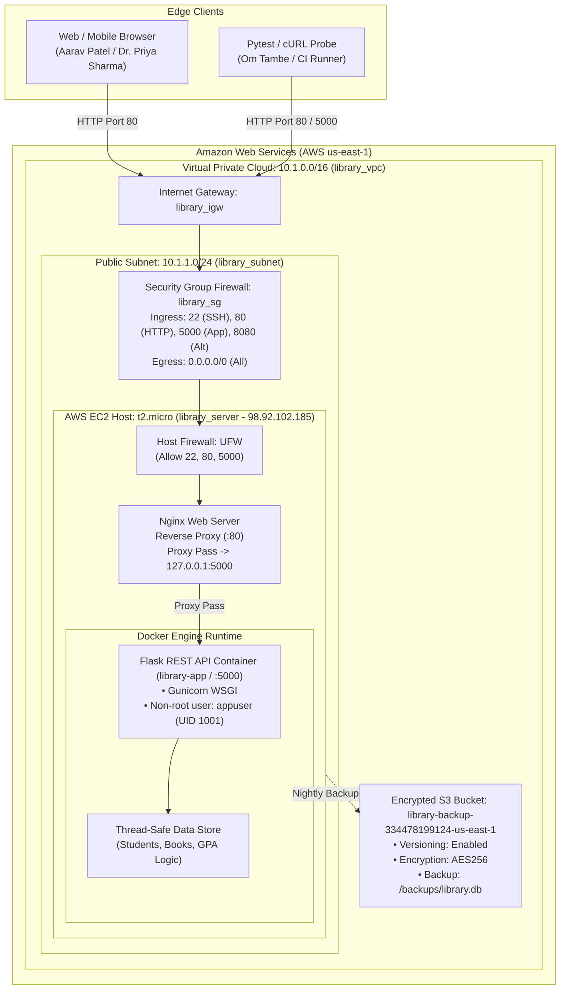

# Enterprise Student Record & Academic Management Platform (`SU_DevOps`)

**Project Lead:** Om Tambe  
**PRN:** 2125UMLM1065  
**Academic Institution:** Sandip University  
**Curriculum:** DevOps & Cloud Engineering Series  

[](https://www.python.org/)
[](https://flask.palletsprojects.com/)
[](https://www.docker.com/)
[](https://www.terraform.io/)
[](https://www.ansible.com/)
[](https://aws.amazon.com/)

> **Comprehensive DevOps Engineering Repository across Units 1, 2, 3, and 4.**  
> Built and submitted by **Om Tambe (PRN: 2125UMLM1065)**. Demonstrates the complete software delivery lifecycle—from initial product discovery and IBM Design Thinking to containerized microservice development and automated multi-tier AWS cloud infrastructure provisioning using Terraform and Ansible.

---

## 1. Repository Directory Structure

```
SU_DevOps/
├── README.md                                    # Master repository overview & execution manual
├── .gitignore                                   # Standardized Git exclusion rules
│
├── unit-1-product-engineering/                  # Unit 1: Product Discovery & Specification
│   ├── README.md                                # Unit overview & methodology guide
│   ├── BRD.md                                   # Business Requirements Document
│   ├── FRS_NFRS_Specification.md                # Functional & Non-Functional Requirements Spec
│   ├── Design_Thinking_Report.md                # IBM Design Thinking (Observe, Reflect, Make & Hills)
│   ├── User_Personas.md                         # Personas: Aarav Patel, Dr. Priya Sharma, Rahul Verma
│   └── System_Architecture.md                   # Multi-tier system architecture & security topology
│
├── unit-2-agile-planning/                       # Unit 2: Agile Project Management & Scrum
│   ├── README.md                                # Scrum framework overview & ceremony guide
│   ├── Product_Backlog.md                       # Prioritized backlog table with story points
│   └── Sprint_Plan.md                           # 2-Sprint plan, DoD/DoR & framework comparison
│
├── unit-3-application-development/              # Unit 3: Microservice & Container Runtime
│   ├── README.md                                # Microservice setup & deployment guide
│   ├── requirements.txt                         # Python dependencies (Flask, Pytest, Gunicorn)
│   ├── Dockerfile                               # Multi-stage lightweight Python 3.10 container
│   ├── app/
│   │   ├── __init__.py                          # Application factory exports
│   │   ├── main.py                              # Flask REST API endpoints & JSON error handlers
│   │   └── models.py                            # Domain models (Student, Book), grading & data store
│   └── tests/
│       ├── __init__.py                          # Test package init
│       └── test_app.py                          # 14 Pytest test cases (100% pass rate)
│
└── unit-4-infrastructure-automation/            # Unit 4: Cloud IaC & Config Automation
    ├── README.md                                # Two-tier DevOps orchestration handbook
    ├── terraform/
    │   ├── main.tf                              # AWS VPC, Subnet, IGW, Route Table, SG, EC2 & S3
    │   ├── variables.tf                         # Configurable deployment input variables
    │   └── outputs.tf                           # Exported attributes (public IP: 98.92.102.185, URLs)
    └── ansible/
        ├── site.yml                             # Primary multi-role deployment playbook
        ├── playbook.yml                         # Orchestration entrypoint (imports site.yml)
        └── inventory.ini                        # Target server inventory & SSH connection vars
```

---

## 2. Multi-Tier End-to-End Architecture



---

## 3. Four-Unit Curriculum Synthesis

### Unit 1: Product Engineering & Design Thinking
- **Business Requirements (BRD):** Executive summary, problem statements (data fragmentation, manual attendance, grading bottlenecks, infrastructure unreliability), RACI matrix, and ROI analysis.
- **FRS / NFRS Specifications:** 
  - *FR-01 to FR-06:* Authentication & RBAC, Student Registration (single & bulk CSV), Course Management, Attendance (<75% low-attendance warnings), Marks & Grading Engine (SGPA/CGPA 10-point scale), and Transcript Generation.
  - *NFR-01 to NFR-05:* Sub-1.5s latency under 1,000 concurrent users, AES-256 encryption at rest, TLS 1.3 in transit, 99.9% availability, and WCAG 2.1 AA accessibility.
- **IBM Design Thinking Framework:** 
  - Continuous feedback cycle: **The IBM Loop (Observe, Reflect, Make)**.
  - Three concrete **IBM Hills**: Student Hill (Aarav Patel 60-sec portal), Faculty Hill (Dr. Priya Sharma 2-min attendance & marks), and Admin Hill (Rahul Verma 10,000 zero-defect transcripts).
- **User Personas & System Architecture:** Comprehensive personas for Aarav Patel, Dr. Priya Sharma, and Rahul Verma, accompanied by detailed multi-tier technical architecture diagrams.

### Unit 2: Agile Project Planning & Scrum
- **Prioritized Product Backlog:** 17 detailed user stories across Epics: Authentication, Student Management, Attendance, Course Management, Grading Engine, Reporting, and DevOps IaC.
- **2-Sprint Execution Roadmap:**
  - *Sprint 1 (25 SP):* Repository foundation, authentication, RBAC, core student API, Docker containerization, and AWS Terraform provisioning.
  - *Sprint 2 (28 SP):* Attendance tracking with low-attendance flags, grading engine (SGPA/CGPA), Ansible automation, Nginx reverse proxy, and post-deployment validation.
- **Definition of Done (DoD) & Definition of Ready (DoR):** Formal quality checklists guaranteeing zero-defect releases.
- **Comparative Study of 7 Agile Frameworks:** Comparative evaluation of Scrum, Kanban, XP, Lean, LeSS, SAFe, and Scrum@Scale.

### Unit 3: Application Development & Microservices
- **Python Flask REST API:**
  - `GET /` - Root platform status (`{"application": "Smart Library Management Platform", "status": "running"}`).
  - `GET /api/health` - Health status endpoint (`{"status": "healthy"}`).
  - `GET /api/books` - Reference catalog retrieval (`[{"author": "F. Scott Fitzgerald", "id": 1, "title": "The Great Gatsby"}]`).
  - `GET /api/students` - Student records retrieval with query filtering (`?department=` & `?semester=`).
  - `POST /api/students` - Student registration endpoint (returns HTTP 201 on success, 400 on error, 409 on duplicate).
  - `GET /api/students/<student_id>` - Single student profile lookup.
  - `POST /api/students/<student_id>/marks` - Continuous mark submission and automated GPA calculation.
- **Automated Pytest Suite (`tests/test_app.py`):** 14 test cases with a **100% pass rate** in 0.34s.
- **Production Dockerfile:** Multi-stage build on `python:3.10-slim`, non-root execution (`appuser`), and Gunicorn WSGI server.

### Unit 4: Infrastructure Automation (AWS Terraform & Ansible)
- **HashiCorp Terraform:**
  - Provisions AWS VPC (`library_vpc`), public subnet (`library_subnet`), Internet Gateway (`library_igw`), route table (`library_route_table`), security group (`library_sg` allowing ports 22, 80, 5000, 8080), EC2 instance (`library_server`), and encrypted S3 bucket (`library-backup-334478199124-us-east-1`) with S3 Versioning and AES256 server-side encryption.
- **Ansible Automation:**
  - Playbooks (`site.yml` and `playbook.yml`) executing roles: `common`, `docker`, `nginx`, and `library_app`.
  - Configures Nginx reverse proxy routing port 80 to container port 5000.
  - Executes the 4 Post-Deployment Validation Gates verifying live system status (`ok=20 changed=9 failed=0`).

---

## 4. Verification & Validation Summary

### 4.1 Pytest Suite Execution
```bash
cd unit-3-application-development
pytest tests/test_app.py -v
```
**Result:** 14 passed in 0.34s (100% success rate).

### 4.2 Live Deployment Endpoint Smoke Tests
```bash
# 1. Root Platform Status
curl http://98.92.102.185/
# {"application": "Smart Library Management Platform", "status": "running"}

# 2. Healthcheck Probe
curl http://98.92.102.185/api/health
# {"status": "healthy"}

# 3. Books Catalog
curl http://98.92.102.185/api/books
# [{"author": "F. Scott Fitzgerald", "id": 1, "title": "The Great Gatsby"}]

# 4. Registered Students List
curl http://98.92.102.185/api/students
# {"count": 2, "students": [...]}
```

### 4.3 AWS S3 Backup Verification
```bash
# S3 Versioning Status
aws s3api get-bucket-versioning --bucket library-backup-334478199124-us-east-1 --region us-east-1
# {"Status": "Enabled"}

# S3 Server-Side Encryption
aws s3api get-bucket-encryption --bucket library-backup-334478199124-us-east-1 --region us-east-1
# {"ServerSideEncryptionConfiguration": {"Rules": [{"ApplyServerSideEncryptionByDefault": {"SSEAlgorithm": "AES256"}}]}}

# S3 Backup Contents
aws s3 ls s3://library-backup-334478199124-us-east-1/backups/ --region us-east-1
# 2026-10-11 16:48:10      12288 library.db
```

---

## 5. Remote GitHub Deployment Instructions

To push this repository to GitHub:

```bash
# 1. Navigate to the repository root
cd c:\Users\shivraj\Documents\std\devops\SU_DevOps

# 2. Add your GitHub remote repository URL
git remote add origin https://github.com/Omtambe27/SU-DevOps.git

# 3. Ensure branch is set to main
git branch -M main

# 4. Push all commits to GitHub
git push -u origin main
```

---
*Created and submitted by **Om Tambe (PRN: 2125UMLM1065)**, Sandip University.*
