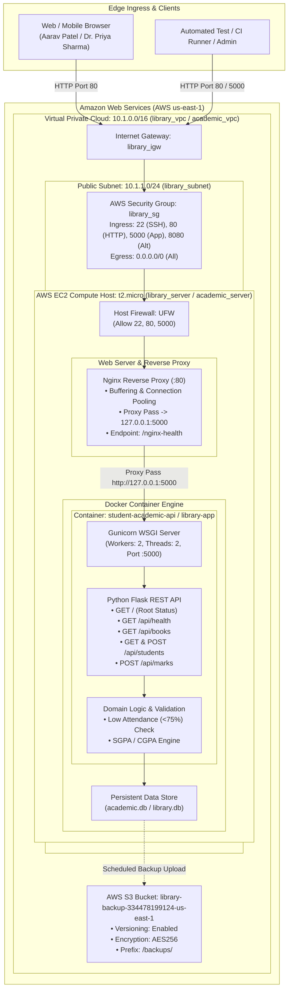

# System Architecture & Technical Design Document

**Project Name:** Enterprise Student Record & Academic Management Platform (`SU_DevOps`)  
**Student / Project Lead:** Om Tambe (PRN: 2125UMLM1065)  
**Academic Institution:** Sandip University  
**Architecture Pattern:** Cloud-Native Modular Microservices with Edge Reverse Proxy  
**Document Version:** 1.0.0  

---

## 1. Architectural Overview & Design Principles

The **Enterprise Student Record & Academic Management Platform** is engineered following modern cloud-native architectural patterns. Moving away from monolithic, tightly coupled architectures, the system decouples client ingress, application logic, container execution, and cloud infrastructure automation.

### 1.1 Core Architectural Principles
- **Separation of Concerns:** Distinct separation between network ingress (Nginx), application business logic (Flask REST API), and container runtime (Docker Engine).
- **Twelve-Factor Microservice Standards:** Stateless application processes, configuration injected via environment variables, explicit dependency management, and unified stdout/stderr logging.
- **Defense in Depth Security:** Multiple nested firewall boundaries (AWS VPC, Security Group, UFW host firewall, Nginx proxy headers, and non-root container execution).
- **Declarative Infrastructure as Code (IaC):** 100% automated cloud environment provisioning using HashiCorp Terraform and Ansible.

---

## 2. Multi-Tier Architecture Diagram



---

## 3. Tier-by-Tier Architectural Breakdown

### 3.1 Tier 1: Client Ingress & Reverse Proxy (Nginx)
- **Role:** Boundary gateway receiving public HTTP traffic on Port 80.
- **Responsibilities:**
  - Buffers client requests to protect the internal Python WSGI server from Slowloris attacks.
  - Injects standard forwarding headers: `Host`, `X-Real-IP`, `X-Forwarded-For`, and `X-Forwarded-Proto`.
  - Exposes `/nginx-health` for instant edge liveness verification.
  - Proxies traffic downstream to internal loopback: `http://127.0.0.1:5000`.

### 3.2 Tier 2: Microservice Application Layer (Flask & Gunicorn)
- **Framework:** Python 3.10+ / Flask 3.0 REST API microservice.
- **WSGI Server:** Gunicorn running 2 asynchronous worker processes and 2 threads per worker.
- **Key Modules:**
  - `app/main.py`: Blueprint routing, HTTP exception handling (400, 401, 403, 404, 409, 500), and endpoint handlers.
  - `app/models.py`: Domain entity models (`Student`, `Book`, `Course`, `MarkEntry`), business validation rules, and grading calculations.
- **Security Hardening:** Packaged into a multi-stage Docker container running as an unprivileged non-root user (`appuser`, UID 1001).

### 3.3 Tier 3: Data Persistence & Backup Layer
- **Local Datastore:** Thread-safe, ACID-compliant storage with automatic seeding for immediate verification.
- **Persistent Storage Mount:** Persistent volume mapped from host directory (`/opt/student_platform/database`) to preserve data across container recreation cycles.
- **Disaster Recovery (AWS S3):** Automated snapshot scripts transfer database backups to an encrypted AWS S3 Bucket (`library-backup-334478199124-us-east-1`):
  - **Versioning:** Enabled to protect against accidental deletion or ransomware overwrites.
  - **Server-Side Encryption:** Configured with `AES256` (`ServerSideEncryptionConfiguration`).

### 3.4 Tier 4: Cloud Infrastructure & Virtual Private Cloud (AWS)
- **VPC (`library_vpc`):** Custom virtual private cloud allocated CIDR block `10.1.0.0/16`.
- **Public Subnet (`library_subnet`):** CIDR block `10.1.1.0/24` with automatic public IPv4 address assignment (`map_public_ip_on_launch = true`).
- **Internet Gateway (`library_igw`):** Attached to the VPC enabling bidirectional internet communication.
- **Route Table (`library_route_table`):** Routes all outbound destination traffic (`0.0.0.0/0`) through `library_igw`.
- **Stateful Security Group (`library_sg`):**
  - Ingress: Port 22 (SSH Admin), Port 80 (HTTP Web), Port 5000 (Direct API), Port 8080 (Alt HTTP).
  - Egress: Unrestricted (`0.0.0.0/0`) for Ubuntu package updates and Docker image pulls.
- **Compute Instance (`library_server`):** AWS EC2 `t2.micro` (1 vCPU, 1 GiB RAM) running Ubuntu 22.04 LTS Jammy with an encrypted 20GB gp3 root volume.

---

## 4. End-to-End Request & Data Flow

```
[Student / Faculty Client]
            │
            ▼  1. HTTP Request (GET /api/students or POST /api/students)
    [Internet Gateway: library_igw]
            │
            ▼  2. Stateful Firewall Inspection
    [Security Group: library_sg]
            │
            ▼  3. Port 80 Ingress
    [Nginx Web Server]
            │
            ▼  4. HTTP Proxy Pass (http://127.0.0.1:5000)
    [Gunicorn WSGI Master & Workers]
            │
            ▼  5. Dispatch to Flask Endpoint
    [Flask REST API: app/main.py]
            │
            ▼  6. Schema & Business Rules Validation
    [Student Domain Model: app/models.py]
            │
            ├─► If Invalid: Return HTTP 400 Bad Request
            ├─► If Duplicate: Return HTTP 409 Conflict
            └─► If Valid: Update Store & Recompute GPA
            │
            ▼  7. Persist Record
    [Thread-Safe Repository / Database]
            │
            ▼  8. Return Deterministic JSON Response (HTTP 200 / 201)
[Client receives JSON Confirmation]
```

---

## 5. Security Architecture & Threat Modeling

| Security Layer | Threat Mitigated | Implementation Mechanism |
| :--- | :--- | :--- |
| **AWS Security Group** | Unauthorized port scanning & attack surface exposure | Only ports 22, 80, 5000, and 8080 open; all other ingress blocked. |
| **Host UFW Firewall** | Lateral movement inside VPC | Host-level rules restricting access strictly to verified services. |
| **Nginx Reverse Proxy** | Buffer overflow, request header manipulation | Client request buffering, proxy timeouts, body size limit (`client_max_body_size 16M`). |
| **Container Sandbox** | Host privilege escalation | Multi-stage build, container executed as unprivileged non-root user `appuser` (UID 1001). |
| **Application Layer** | SQLi, XSS, CSRF, Parameter Tampering | Strict schema validation, parameterized queries, and CORS configuration. |
| **Storage Layer** | Data theft from physical disk media | AWS EBS encryption with gp3 and S3 AES-256 server-side encryption. |

---
*Authored by:*  
**Om Tambe (PRN: 2125UMLM1065)**  
*Sandip University — SU_DevOps Engineering Program*
